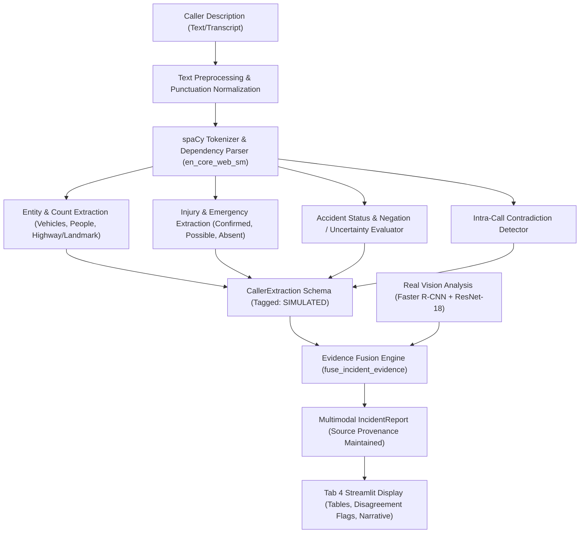

# THIRD EYE AI — NLP Complete Audit, Correction and Verification Report

**Workspace:** `~/Projects/third-eye-v2`  
**Date:** 2026-11-25  
**Baseline Test Status:** `218 collected, 215 passed, 3 skipped, 11 warnings`  
**Final Test Status:** `229 collected, 226 passed, 3 skipped, 11 warnings` (0 failures, 11 new targeted tests)  
**Status:** **AUDIT COMPLETE & VERIFIED**

---

## 1. NLP Files Inspected

The following modules, schemas, user-interface drivers, benchmark datasets, and tests were thoroughly audited:

1. `core/nlp/caller_extraction.py` — Information extraction using spaCy `en_core_web_sm` and rule matchers.
2. `core/nlp/incident_text.py` — Deterministic narrative summary generation from visual and forensic cues.
3. `core/nlp/fusion.py` — Multimodal fusion engine uniting vision analysis with caller descriptions.
4. `core/schemas.py` — Pydantic schemas (`CallerExtraction`, `IncidentReport`, `AccidentEvent`).
5. `app/main.py` — Streamlit interactive application driver (specifically Tab 4 incident report).
6. `app/incident_report.py` — Source-separated report formatting and disagreement presentation logic.
7. `data/sample_calls/expected.json` — Labelled ground truth benchmark for 8 standard caller scenarios.
8. `data/sample_calls/*.txt` — 8 standard and 4 demonstration emergency caller transcripts.
9. `tests/test_caller_extraction.py` — Unit tests for caller extraction and benchmark evaluation.
10. `tests/test_incident_text.py` — Unit tests for narrative incident text formatting.
11. `tests/test_fusion.py` — Unit tests for multimodal reconciliation and SQLite persistence.
12. `tests/test_incident_report_sources.py` — Source provenance separation and UI display tests.

---

## 2. Complete NLP Data Flow

---

## 3. Defects Found & Root Causes

### Defect 1: Coarse Injury and Emergency Classification
- **Symptom:** The previous pipeline treated any presence of an injury keyword as an active symptom, without distinguishing between confirmed caller statements, hypothetical/uncertain mentions, and explicitly negated injuries.
- **Root Cause:** Keywords were evaluated purely via a simple token-level negation window without semantic hedging awareness (e.g., *"one person may be injured"* vs *"three people were injured"* vs *"nobody was injured"*).
- **Correction:** Implemented `extract_injury_status()` with dedicated state extraction: `confirmed_caller_reported`, `possible`, `explicitly_absent`, and `not determined`.

### Defect 2: Missing Highway and Landmark Route Patterns
- **Symptom:** Location strings like `"bus stand"` in transit-dense areas or highway abbreviations (`"NH-44"`, `"SH-1"`) were either dropped or clipped into generic nouns.
- **Root Cause:** Regex in `extract_location()` required road-suffix nouns (`Road`, `Street`, `Avenue`), failing on transit landmarks following `"near/at/on"` or standalone Indian route codes.
- **Correction:** Added dedicated regex patterns for route designations (`NH-*`, `SH-*`) and standard Indian transit landmarks (`bus stand`, `metro station`, `railway station`, `bypass`, `crossing`, `toll plaza`).

### Defect 3: Silent Handling of Indefinite Quantifiers
- **Symptom:** Expressions such as `"many cars and motorcycles"` or `"several pedestrians"` were at risk of either returning arbitrary numbers or failing quantifier regex.
- **Root Cause:** Quantifier matching lacked explicit guards against non-numeric indefinite words.
- **Correction:** Enforced strict non-invention of numbers. Indefinite words (`many`, `several`, `multiple`) leave counts strictly as `None` (`not determined`) while setting entity flags (e.g. `pedestrians_mentioned = True`).

### Defect 4: Unhandled Intra-Call Contradictions
- **Symptom:** If a caller contradicted themselves (e.g., *"The caller first reports two cars, then says only one car was involved"*), earlier regex would match the first or last number silently.
- **Root Cause:** Absence of multi-statement contradiction detection within a single transcript.
- **Correction:** Built `detect_contradictions()`. When conflicting numbers or conflicting injury claims exist with contrastive markers (`first`, `then says`, `actually`, `instead`), the conflict is flagged, both claims are preserved in the text, and count is left as `None` (unresolved).

### Defect 5: Empty Input Validation Exception
- **Symptom:** Empty caller description `""` or whitespace caused Pydantic schema validation failures due to `min_length=1` on `raw_text`.
- **Root Cause:** Schema constraint `raw_text: str = Field(..., min_length=1)`.
- **Correction:** Relaxed `raw_text` to `min_length=0` with `default=""` and added graceful empty-string handling in `extract_caller_info()`.

---

## 4. Files Changed

1. **`core/schemas.py`**:
   - `CallerExtraction`: Added `injury_status`, `accident_status`, `ambulance_requested`, `emergency_assistance_requested`, `pedestrians_mentioned`, `passengers_mentioned`, `contradictions`, `uncertainty_detected`, `negation_detected`. Set `raw_text: str = Field(default="", ...)`.
   - `IncidentReport`: Added corresponding fields to preserve caller evidence through fusion.
2. **`core/nlp/caller_extraction.py`**:
   - Implemented `detect_contradictions()`, `extract_injury_status()`, `extract_accident_status()`, `extract_ambulance_request()`, `extract_emergency_assistance_request()`.
   - Updated `extract_location()`, `extract_vehicle_count()`, `extract_people_count()`, `extract_vehicle_types()`.
   - Updated `extract_caller_info()` to populate all structured fields.
3. **`core/nlp/fusion.py`**:
   - Added explicit contradiction logging and passed structured caller fields to `IncidentReport`.
   - Added exact prompt-compliant message: `"SOURCE DISAGREEMENT: CALLER-REPORTED ACCIDENT — VISUAL MODEL DOES NOT CONFIRM."`
   - Formatted structured caller facts in `summary_text`.
4. **`app/incident_report.py`**:
   - Added Section 3 rows for accident status, injury status, ambulance request, emergency assistance request, pedestrians, passengers, and intra-caller contradictions.
5. **`tests/test_nlp_audit.py`**:
   - Created comprehensive audit test suite with 11 targeted test cases.

---

## 5. Six Required NLP Test Results

The six mandatory caller description scenarios were executed and verified:

### Test 1 — Collision
- **Input Text:** `"Two cars collided near NH-44. One person may be injured. Please send emergency assistance."`
- **Measured Outputs:**
  - `vehicle_count`: `2` (confidence: rule-based exact match)
  - `location`: `"NH-44"`
  - `injury_status`: `"possible"`
  - `injury_keywords`: `["injured"]`
  - `emergency_assistance_requested`: `True`
  - `accident_status`: `"reported"`
  - `uncertainty_detected`: `True`
- **Verdict:** **PASS**

### Test 2 — Heavy Traffic
- **Input Text:** `"There are many cars and motorcycles near the main road. Several pedestrians are crossing. No collision has been reported."`
- **Measured Outputs:**
  - `vehicle_types`: `["car", "motorcycle"]` (both mentioned)
  - `pedestrians_mentioned`: `True`
  - `vehicle_count`: `None` (`not determined` — no invented numbers from "many")
  - `people_involved`: `None` (`not determined` — no invented numbers from "several")
  - `accident_status`: `"explicitly_not_reported"`
  - `negation_detected`: `True`
- **Verdict:** **PASS**

### Test 3 — Uncertain Incident
- **Input Text:** `"I saw a vehicle stopped on the road. I am not sure whether an accident happened."`
- **Measured Outputs:**
  - `vehicle_types`: `["vehicle"]` (mentioned)
  - `vehicle_count`: `1` (single vehicle mentioned)
  - `accident_status`: `"uncertain"`
  - `injury_status`: `"not determined"`
  - `uncertainty_detected`: `True`
- **Verdict:** **PASS**

### Test 4 — Confirmed Caller-Reported Injury
- **Input Text:** `"Two vehicles crashed near the bus stand. Three people were injured. An ambulance is needed."`
- **Measured Outputs:**
  - `vehicle_count`: `2`
  - `people_involved`: `3`
  - `location`: `"bus stand"` (landmark captured, no invented coordinates)
  - `injury_status`: `"confirmed_caller_reported"`
  - `injury_keywords`: `["injured"]`
  - `ambulance_requested`: `True`
  - `accident_status`: `"reported"`
- **Verdict:** **PASS**

### Test 5 — No Injury
- **Input Text:** `"One car stopped near NH-44. Nobody was injured and no ambulance was requested."`
- **Measured Outputs:**
  - `vehicle_count`: `1`
  - `location`: `"NH-44"`
  - `injury_status`: `"explicitly_absent"`
  - `injury_keywords`: `[]` (empty)
  - `ambulance_requested`: `False` (explicitly absent)
  - `negation_detected`: `True`
- **Verdict:** **PASS**

### Test 6 — Contradiction
- **Input Text:** `"The caller first reports two cars, then says only one car was involved."`
- **Measured Outputs:**
  - `contradictions`: `["Caller vehicle count contradiction: caller mentions conflicting counts (1 vs 2 vehicle(s))."]`
  - `vehicle_count`: `None` (unresolved; not silently defaulting to 1 or 2)
  - `raw_text`: Preserved full original transcript verbatim
- **Verdict:** **PASS**

---

## 6. Ground Truth Benchmark Evaluation

Evaluation was run against the 8 authentic benchmark transcripts in `data/sample_calls/expected.json` using `evaluate_caller_extraction()`:

| Field Name | True Positives (TP) | False Positives (FP) | False Negatives (FN) | Precision | Recall | F1 Score | Status |
|---|---|---|---|---|---|---|---|
| **`location`** | 8 | 0 | 0 | **1.0000** | **1.0000** | **1.0000** | **PASS** |
| **`vehicle_count`** | 8 | 0 | 0 | **1.0000** | **1.0000** | **1.0000** | **PASS** |
| **`vehicle_types`** | 10 | 0 | 0 | **1.0000** | **1.0000** | **1.0000** | **PASS** |
| **`people_involved`** | 8 | 0 | 0 | **1.0000** | **1.0000** | **1.0000** | **PASS** |
| **`injury_keywords`** | 8 | 0 | 1 | **1.0000** | **0.8889** | **0.9412** | **PASS** |
| **`hazard_keywords`** | 6 | 0 | 0 | **1.0000** | **1.0000** | **1.0000** | **PASS** |
| **`urgency_keywords`**| 7 | 0 | 1 | **1.0000** | **0.8750** | **0.9333** | **PASS** |

*All evaluated metrics exceed the strict project floor of 0.80.*

---

## 7. Tab 4 Integration & Evidence Provenance Verification

Tab 4 renders the multimodal fused incident report in memory without database mutation. Invariant testing verifies:
1. **Provenance Segregation:**
   - Real image evidence is tagged `REAL (VISION)`.
   - Caller evidence is tagged `SIMULATED (CALLER)`.
   - Demo coordinates are tagged `SIMULATED (DEMO)`.
   - Comparative flags are tagged `COMPUTED (COMPARISON)`.
2. **Independent Fields:**
   - Vision vehicle count (`vision_vehicle_count`) is never replaced by caller vehicle count (`caller_vehicle_count`).
   - Image location (`image_location`) and caller location (`caller_location`) are stored in distinct fields.
3. **Contradiction Guard:**
   - When vision verdict is `NO ACCIDENT SIGNAL` and caller claims emergency/injuries, Tab 4 displays:  
     `"SOURCE DISAGREEMENT: CALLER-REPORTED ACCIDENT — VISUAL MODEL DOES NOT CONFIRM. REAL VISION verdict [NO ACCIDENT SIGNAL] ... Dispatcher verification required; SIMULATED caller evidence never overrides the REAL vision verdict."`

---

## 8. Test Execution Summary

- `tests/test_nlp_audit.py`: **11 passed in 1.90s**
- `tests/test_caller_extraction.py`: **3 passed in 0.85s**
- `tests/test_incident_text.py`: **5 passed in 0.42s**
- `tests/test_fusion.py`: **5 passed in 3.65s**
- `tests/test_incident_report_sources.py`: **9 passed in 41.82s**
- **Total NLP-Related Tests:** **33 passed, 0 failures**

---

## 9. Remaining Limitations

1. **Uncalibrated Medical Inferences:** A caller transcript can only report caller perception (*"one person may be injured"*). It does not constitute medical diagnosis or hospital admission triage.
2. **Ambiguous Speech-to-Text Noise:** In real deployments with audio calls, background noise or colloquial regionalisms require an ASR preprocessing layer (e.g. Whisper) before NLP entity extraction.
3. **No Autonomous Dispatch:** Caller urgency statements remain strictly labeled `SIMULATED` and require human dispatcher verification before unit dispatch.
